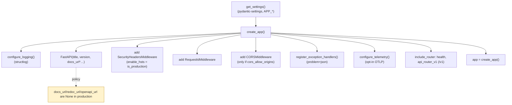
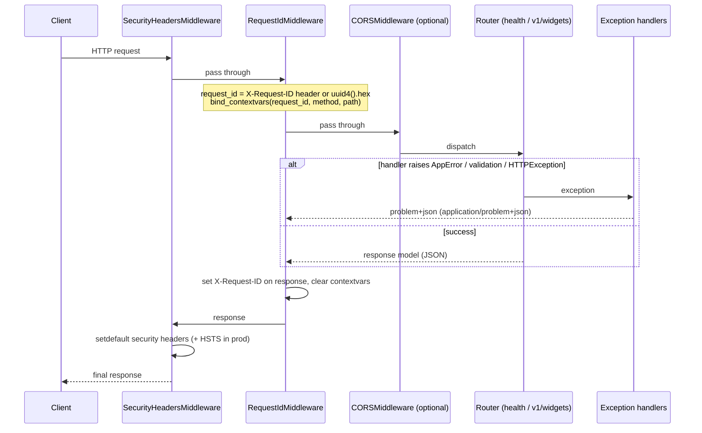
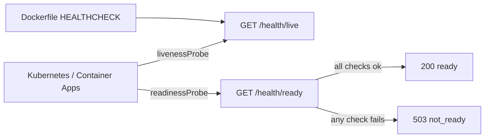

# Architecture

This document describes how the **FastAPI** microservice is assembled and how a
request flows through middleware, routing, error handling, and observability. It
mirrors the code under `src/app/`; keep it in sync when the wiring changes.

## Module layout

```
src/app/
  __init__.py              __version__
  main.py                  create_app() factory + ASGI `app`
  config.py                Settings (pydantic-settings, APP_* env), get_settings()
  logging.py               structlog JSON/console logging
  telemetry.py             optional OpenTelemetry tracing (otel extra)
  exceptions.py            domain errors + RFC 9457 problem+json handlers
  middleware/
    request_id.py          X-Request-ID correlation, structlog contextvars
    security_headers.py    baseline HTTP security headers (+ optional HSTS)
  api/
    health.py              /health/live, /health/ready
    v1/
      __init__.py          api_router_v1 (prefix /v1)
      widgets.py           example resource: models + in-memory repo + router
```

## Application assembly (`create_app`)

`create_app()` is the composition root. Order matters: middleware added **last**
runs **outermost** (closest to the client).



The `_lifespan` async context manager logs structured `app.startup` /
`app.shutdown` events with the service name, environment, and version.

Interactive docs (`/docs`, `/redoc`, `/openapi.json`) are **disabled in
production** (`docs_url=None` when `settings.is_production`); expose them via the
gateway if needed.

## Request flow

Middleware stack (outermost first), then routing, then the response path:



### Security headers

`SecurityHeadersMiddleware` applies an API-oriented baseline with `setdefault`
(so it never clobbers a header a handler intentionally set):

| Header                          | Value                                            |
| ------------------------------- | ------------------------------------------------ |
| `X-Content-Type-Options`        | `nosniff`                                         |
| `X-Frame-Options`               | `DENY`                                            |
| `Referrer-Policy`               | `no-referrer`                                     |
| `Content-Security-Policy`       | `default-src 'none'; frame-ancestors 'none'`     |
| `Cross-Origin-Opener-Policy`    | `same-origin`                                     |
| `Cross-Origin-Resource-Policy`  | `same-origin`                                     |
| `Permissions-Policy`            | `geolocation=(), camera=(), microphone=()`       |
| `Strict-Transport-Security`*    | `max-age=63072000; includeSubDomains; preload`   |

\* HSTS is added only when `enable_hsts=True`, i.e. in production (TLS-terminated).

### Errors (RFC 9457 problem+json)

`register_exception_handlers` maps exceptions to `application/problem+json`:

| Source                         | Status | Title                  |
| ------------------------------ | ------ | ---------------------- |
| `NotFoundError` (`AppError`)   | 404    | Not Found              |
| `ConflictError` (`AppError`)   | 409    | Conflict               |
| `RequestValidationError`       | 422    | Unprocessable Entity   |
| `StarletteHTTPException`       | as-is  | the exception detail   |
| any unhandled `Exception`      | 500    | Internal Server Error  |

Unhandled exceptions are logged server-side with full `exc_info`; internals are
never leaked to the client.

## Observability flow

```mermaid
graph LR
  subgraph Per-request
    ReqId["RequestIdMiddleware"] -->|bind request_id| CtxVars["structlog contextvars"]
  end

  CtxVars --> Logger["get_logger(__name__)"]
  Logger --> Processors["merge_contextvars · add_log_level ·<br/>ISO TimeStamper · logger_name · exc_info"]
  Processors -->|APP_LOG_JSON=true| JSON["JSONRenderer → stdout"]
  Processors -->|APP_LOG_JSON=false| Console["ConsoleRenderer → stdout"]

  Stdlib["uvicorn / stdlib logging"] -->|ProcessorFormatter| Processors

  subgraph Tracing (opt-in)
    OtelFlag["APP_OTEL_ENABLED=true"] --> Otel["configure_telemetry()"]
    Otel --> Instr["FastAPIInstrumentor + HTTPXClientInstrumentor"]
    Instr --> Exporter["OTLP exporter → APP_OTEL_EXPORTER_OTLP_ENDPOINT"]
  end
```

- **Logging** — structlog. JSON in production (`APP_LOG_JSON=true`), console
  locally. Every record carries `request_id`, `method`, and `path` from the
  request-id middleware contextvars. stdlib/uvicorn logs are routed through the
  same formatter so output is uniform. Use `get_logger(__name__)`; never
  `print`.
- **Correlation** — `RequestIdMiddleware` honours an inbound `X-Request-ID` or
  generates a `uuid4().hex`, binds it for the request, and echoes it on the
  response.
- **Tracing** — opt-in via `APP_OTEL_ENABLED=true` and the `otel` extra. Spans
  export to `APP_OTEL_EXPORTER_OTLP_ENDPOINT`. The `/health/live` and
  `/health/ready` probes are excluded from traces. Setup is defensive: missing
  deps or a bad endpoint log a warning and never crash the app.

## Health & deployment



- `/health/live` — liveness; cheap, dependency-free; orchestrators restart the
  pod if it fails. Also the container `HEALTHCHECK` target.
- `/health/ready` — readiness; returns 503 when any dependency check fails so no
  traffic is routed. Extend the `checks` dict with real probes (DB, cache,
  upstreams).

The service runs as non-root uid `65532` on `gcr.io/distroless/cc-debian13` (with a bundled uv-managed CPython 3.12)
via the multi-stage `Dockerfile`, served by `uvicorn app.main:app` (one worker
per container; scale horizontally via replicas).

See [`RUNBOOK.md`](./RUNBOOK.md) for operational procedures (endpoints, env
vars, common incidents, rollback).
